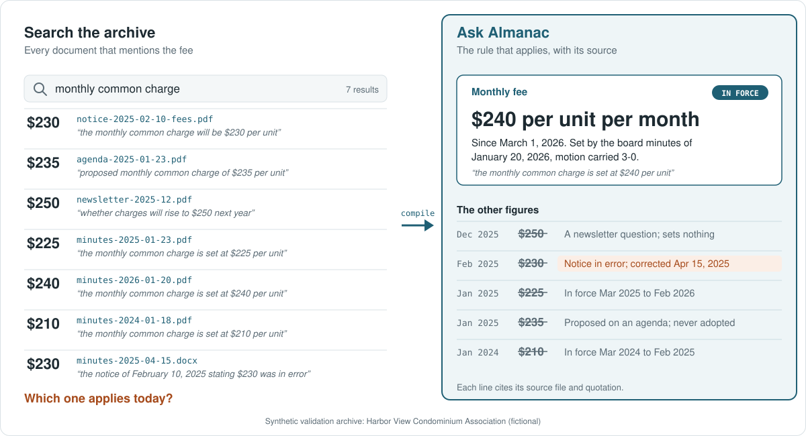

# Almanac

Almanac is a Skill for the UGREEN AI NAS. It compiles the records of an HOA, condo or club association into a versioned, cited rulebook, and answers questions about which rule currently applies, since when, and on whose authority. It is meant for the volunteer boards and managers who keep those records.

It was written for the UGREEN Hackathon 2026 (track: Automate Your Workflow). The Skill is named `almanac`.

## The problem

An association's rules are rarely kept in one place. They are set in bylaws, changed in meeting minutes, announced in notices, constrained by contracts and sometimes discussed in recorded meetings. Over the years, later decisions replace earlier ones, a notice occasionally states the wrong figure, and a proposal that failed can be mistaken for one that passed. A search of the archive therefore returns every version of a rule, current or not, and leaves the reader to work out which one still applies. Answering a simple question, such as the current monthly fee or how many pets a unit may keep, means reading the whole history.

The test archive in this repository shows the problem. It is a synthetic archive for a fictional 48-unit condominium association, with 15 documents and a meeting recording from 2019 to 2026, built to test Almanac. In it, a search for the monthly fee returns seven documents and six different figures: a $235 proposal that was never adopted, a notice that wrongly gave $230, a newsletter question about $250, two fees that applied in earlier years and the current fee of $240. Almanac records which one applies and what each of the others was.



## The approach

A search tool matches words. It finds every document that mentions a topic but cannot tell which statement is still in force. Almanac answers that question: it reads the whole archive, works out which decisions replaced which, and records the result as a rulebook in which every rule cites its source.

Almanac does this in a compile. Each compile produces a Markdown file in an almanac folder on the NAS. For every topic, the file records the current rule, its scope and effective date, and the vote or document that established it, with a quotation from the source. It also lists the rules it replaced and when each applied, any change scheduled for a later date, and any conflict the documents leave unresolved. Each version also has a changelog of what changed since the previous one, and the user reviews it before the version is saved. The changelog compares each topic's summary (rule, scope, effective date and status) and the open items. A change only to a topic's authority or evidence, such as a corrected vote count, appears in the topic but is not flagged as a change. Older versions are never modified, so the folder also serves as an audit trail.

The rules for deciding which statement is current are set out in [the supersession rules](skill/almanac/references/supersession-rules.md). A later adopted decision replaces an earlier one only for the same subject and scope, so an amendment that changes quiet hours on Friday and Saturday nights leaves the other nights untouched. Failed motions and agenda proposals never change a rule. A notice that contradicts the minutes is recorded as a conflict unless a later document corrects it. When nothing resolves a disagreement, the almanac quotes both statements and leaves the decision to the board.

Adopted changes that take effect later are recorded as scheduled, and a question about a date after the change gets the new rule. Almanac has no background scheduler. When the user next runs a compile after that date, it proceeds even if no file has changed, and the saved version makes the new rule current.

Questions are answered from the newest almanac rather than from the raw archive. Each answer gives the rule, its source and the almanac version it came from, and says so when the almanac does not cover the question.

## How a compile runs

The Skill delegates every step to the UGOS agents (`file-agent`, `document-agent` and `knowledge-agent`) and never calls a command-line tool directly.

1. The Skill lists every file in the board folder with a checksum, a fingerprint of the file's contents, so it can later tell whether any file was added, changed or removed. The newest almanac supplies only its version number and, for the changelog, its summary table and open items. If nothing has changed and no scheduled change has taken effect, the almanac is reported as current.
2. Meeting recordings are transcribed. Anything decided only in a recording is marked provisional.
3. Every document is read again, up to 60 files per compile. Decisions, rules, votes, effective dates, action items and contract terms are extracted, each with a quotation and its source file. A file that cannot be read stops the compile until the user fixes it or explicitly excludes it, and an almanac built without it is marked as compiled with exclusions.
4. The documents are compared with each other, and every disagreement is reported rather than decided.
5. The supersession rules are applied and the whole almanac is written again from these records. Because nothing is carried over from the previous version, a corrected or deleted document cannot leave an outdated rule behind.
6. Before approval, the Skill checks that the summary table, each topic and the review agree. The user then reviews each new or changed rule beside its previous summary value, with the new rule's effective date and quotation, and every change to an open item.
7. The folder is checked again, and if any file changed during the compile, nothing is saved. Otherwise the version is saved after approval under a new name and read back to confirm that it is complete.

The Skill asks which model the NAS uses for document processing. The intended setting is the NAS local model, and a third-party model is used only with the user's explicit authorization. Model routing itself is a UGOS setting that the Skill can confirm but not change. People are recorded by board role, and residents' private matters are left out.

The almanac reports what the documents record. It does not give legal advice or judge whether a vote or notice was valid.

## Existing tools

Hosted HOA platforms such as HOALife and HOA Hub answer questions from an association's uploaded governing documents. [HOALife](https://www.hoalife.com/features/ai-features) offers an AI chat that draws on an HOA's governing documents. HOA Hub answers residents' questions with [EasyAsk](https://www.hoahub.app/features/easyask/), and its [document hub](https://www.hoahub.app/features/documents/) compares an uploaded amendment with the governing document and keeps a version history.

Almanac instead reconciles decisions across the association's whole archive on the NAS, including minutes, notices, recordings and corrections. It records which motions passed or failed, when each change takes effect and where documents disagree, and the user reviews each version before it is saved.

Almanac also runs where the records are kept. Association records name residents and can include disputes, violations and late payments. With the NAS set to its local model, the documents are read on the device and the archive is not uploaded to a hosted platform or AI service. The Skill confirms the model setting before reading any document and uses a third-party model only with the user's explicit authorization.

## Demo

An interactive demo is available at [rc1-dev.github.io/board-almanac](https://rc1-dev.github.io/board-almanac/) (source in [`docs/index.html`](docs/index.html)). It walks through the board folder, the compile run, the resulting almanac with the history of each rule, answers to sample questions, an update and the lint report. A captioned video of the same walkthrough (2:24) is on [YouTube](https://youtu.be/Pia5Y52dYJs); the file is also in [`demo/video/almanac-demo.mp4`](demo/video/almanac-demo.mp4).

Both replay the expected behavior on the synthetic test archive. The delegation text is quoted from `SKILL.md`, and the answers are the reference answers from the validation kit. Results from a UGREEN AI NAS will follow if Almanac is selected as a Finalist.

## Status

The Skill ([`SKILL.md`](skill/almanac/SKILL.md) and six [reference files](skill/almanac/references/)) is complete. It follows the Uliya Skill Development Standard and passes the static check of the official skill kit 0.7.7 (capability catalog 2.2.0) with no errors or warnings ([result](docs/checker-result.json)). The validation kit contains a synthetic archive for a fictional 48-unit building, six adversarial cases, a 23-question answer key and a scorer.

The Skill was tested in 64 simulated runs, in which a small model played the Skill against stand-in agents, and then in 5 targeted runs of the submitted version ([method and results](testing/README.md); every run is archived in [`testing/archive/`](testing/archive/)). Across the 64 runs, the automatic checks detected no save without approval and no instruction hidden in a document carried out. The results led to the current design: a full rebuild on every compile, a compile after a scheduled date that goes ahead even if no file has changed, and a check of the folder before saving.

The tests found errors that remain. The most serious is that a change to part of a rule, or to one period, is sometimes treated as ending the parts that did not change. For example, a pool-hours decision for the 2026 season can hide the standing rule for later seasons. The graded runs also found reviews before saving that left out changes or open items, and steps that were sometimes skipped. Because some reviews were incomplete, the review cannot be relied on to catch every error. The planned fix for the most serious error is to have the document agent state which parts of an earlier rule stay in force.

The Skill has not yet run on a UGREEN AI NAS. If Almanac is selected as a Finalist, it will be tested on the NAS with the validation kit, following [the test plan](skill/almanac/references/test-plan.md). Results there will depend on how well the UGOS agents read documents, scanned pages and recordings. One compile handles up to 60 files.

## Repository layout

| Path | Contents |
|---|---|
| `skill/almanac/` | The Skill package: `SKILL.md` and six reference files |
| `validation/` | Synthetic archive and its generator, answer key, scorer, expected almanac versions and recording script ([details](validation/README.md)) |
| `demo/` | Demo page source and build script, and the video with its filming scripts |
| `docs/` | Built demo page for GitHub Pages, the problem graphic and its script, and the checker result |
| `testing/` | Simulated-test harness, the unseen club archive, and an archive of all 69 runs with their automatic checks and grades ([details](testing/README.md)) |
| `proposal/` | Round 1 proposal source and PDF |
| `scripts/package.sh` | Builds `dist/almanac.zip` and runs the skill kit's static check on it |

## Running the validation kit

```bash
pip install reportlab python-docx        # only needed to regenerate the archive
python3 validation/build_corpus.py       # writes validation/corpus/
python3 validation/score.py validation/selftest/gold_answers.jsonl --recording
```

The reference answers in `validation/selftest/` are written by hand. They confirm that the answer key and scorer agree, and serve as the standard that output from the NAS will be measured against. The kit also contains six adversarial cases with their expected outcomes, including corrected minutes and a change adopted for a later effective date. The generated archive is byte-for-byte reproducible and its checksums are recorded.

## Building

```bash
python3 demo/build_demo.py                                  # rebuilds docs/index.html
UGREEN_KIT=/path/to/uliya-skill-kit scripts/package.sh      # builds and checks the Skill package
```

The UGREEN skill kit is not included in this repository and can be downloaded from the hackathon resources.

## Disclosure

The workflow was designed and written during the UGREEN Hackathon 2026. Claude (Anthropic) assisted with drafting and reviewing the Skill files, test materials, proposal and documentation, and Claude models played the Skill and graded the runs in the simulated tests. The Skill bundles no third-party code, models or services. The validation generator uses reportlab (BSD license) and python-docx (MIT license). All test data is synthetic and fictional, and people appear by board role only.

## License

Copyright 2026 Rajeev Chawla. Licensed under the [Apache License, Version 2.0](LICENSE).
